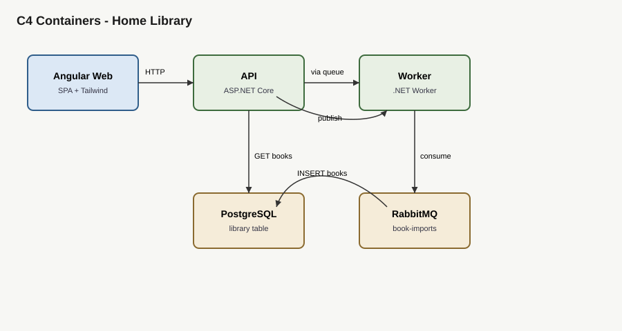
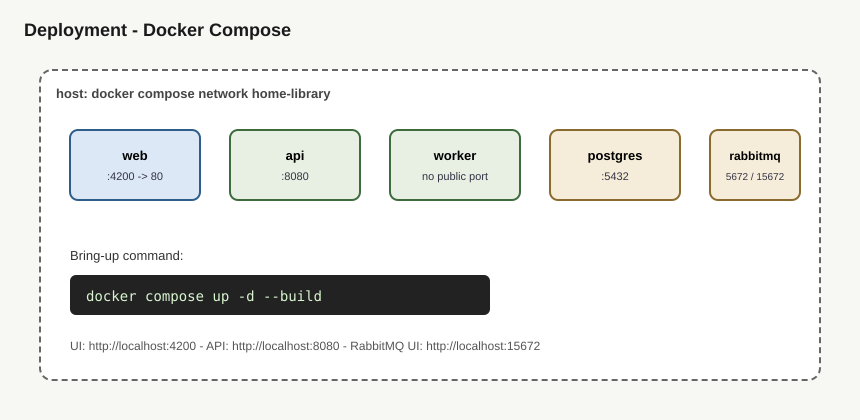

# Architecture Response Document — Home Library

Visual diagrams: open this file with the default VS Code Markdown preview (**Ctrl+Shift+V**).

| Diagram | File |
| --- | --- |
| C4 Context | [diagrams/c4-context.svg](diagrams/c4-context.svg) |
| C4 Containers | [diagrams/c4-containers.svg](diagrams/c4-containers.svg) |
| Deployment | [diagrams/deployment.svg](diagrams/deployment.svg) |
| Import sequence | [diagrams/import-sequence.svg](diagrams/import-sequence.svg) |

---

## Context

### Scope

- Bulk CSV import of books (name, author, genre) via an Angular UI.
- ASP.NET Core API accepts the upload, parses rows, and publishes one message per valid row to RabbitMQ.
- A separate Worker process consumes messages and inserts into PostgreSQL `library`.
- UI lists imported books (name, author, genre, import date) and polls after upload.
- Full stack runs with Docker Compose.

### Out of Scope

- Authentication / authorization
- Deduplication of books
- Large-file streaming, batching, or backpressure
- Multi-tenant or cloud production hardening beyond local Compose

---

## Proposed Approach

Layered .NET solution with inward dependencies:

`Presentation (Api / Worker / Angular) → Application → Domain`  
`Infrastructure → Application → Domain`

- **Light domain**: a simple `Book` entity with validation; no value-object ceremony or domain events.
- **Application** use cases: queue an import from CSV; list books.
- **Infrastructure**: EF Core + Npgsql, RabbitMQ adapters, CSV parser.
- **Api** publishes and reads only; **Worker** is the only process that inserts books.
- **Angular** UI with Tailwind; Docker Compose wires postgres, rabbitmq, api, worker, web.

Status at foundation: solution skeleton and CI exist; feature wiring is **target** until subsequent merges.

---

## Individual Components Roles and Responsibilities

| Component | Responsibility |
| --- | --- |
| Angular web | Drag-drop CSV upload; display book list; poll after import |
| HomeLibrary.Api | `POST /api/imports`, `GET /api/books`; publish to RabbitMQ; read Postgres |
| HomeLibrary.Worker | Consume `book-imports`; insert books with UTC `import_date` |
| HomeLibrary.Application | Use cases and ports |
| HomeLibrary.Domain | `Book` rules |
| HomeLibrary.Infrastructure | EF, RabbitMQ, CSV adapters |
| PostgreSQL | Persist `library` rows |
| RabbitMQ | Durable queue between Api and Worker |

---

## Deployment

**Target** topology (Compose):

| Service | Image / build | Host ports (default) |
| --- | --- | --- |
| postgres | `postgres:16` | 5432 |
| rabbitmq | `rabbitmq:3.13-management` | 5672, 15672 |
| api | build `HomeLibrary.Api` | 8080 |
| worker | build `HomeLibrary.Worker` | (none) |
| web | build Angular → nginx | 4200 |

Bring-up command (once services are enabled): `docker compose up -d --build`.

---

## Dependencies

| Dependency | Role |
| --- | --- |
| .NET 10 / ASP.NET Core | Api and Worker runtime |
| EF Core + Npgsql | Persistence |
| RabbitMQ.Client | Messaging |
| PostgreSQL 16 | Database |
| RabbitMQ 3.13 | Broker |
| Angular + Tailwind | UI |
| Docker Compose | Local orchestration |
| xUnit | Unit tests |
| GitHub Actions | CI |

---

## Data Flows / APIs

### HTTP

| Method | Path | Behavior |
| --- | --- | --- |
| `POST` | `/api/imports` | multipart CSV → parse → publish rows → `202` + `queuedCount` |
| `GET` | `/api/books` | books ordered by import date descending |

### Message

Queue: `book-imports`  
Payload: `{ "name", "author", "genre" }`

---

## Security Concerns

Sized to the real surface: local demo / take-home, no public internet exposure assumed.

### CIA

- **Confidentiality** — no personal data beyond sample book metadata; default Compose credentials are local-only demo values.
- **Integrity** — Worker is the sole writer of books; CSV malformed rows are skipped rather than partially corrupting domain rules.
- **Availability** — single-node Compose; no HA. Startup retry for broker/DB is a target resilience measure.

### AuthN / AuthZ

None / public read-write on the local demo surface.

### Secrets

Postgres and RabbitMQ credentials via `.env` / Compose environment. `.env` is gitignored. No secrets in source.

### Transport

TLS not terminated in local Compose (HTTP/AMQP on localhost). Acceptable for local demo only.

### Top risks for this surface

| Risk | Mitigation |
| --- | --- |
| Unauthenticated write of CSV content | Local-only demo; document as out of scope for production |
| Default guest credentials | Documented in `.env.example`; change before any shared host |
| Oversized upload | Assignment assumes small CSVs; reject empty/wrong type at API |

### Threat view (import flow)

- **Assets**: queue integrity, `library` table, host disk via upload.
- **What can go wrong**: malicious CSV, broker unavailable, duplicate processing.
- **Mitigations**: content-type checks, skip bad rows, startup retry (target), at-least-once consume with idempotency deferred (no de-dupe required).

### Fitness checks

- GitHub Actions: restore, build, test on push/PR.
- Expand with lint/format as the solution grows.

---

## COGS

Local Docker Compose only. No cloud spend for the graded path. Approximate laptop cost is developer time plus negligible container CPU/RAM for postgres + rabbitmq + three app containers.
